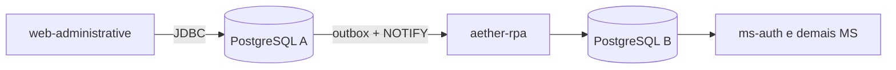

# Aether Web Administrative

Sistema administrativo do [Aether](https://github.com/AetherGases): aplicação **Java Servlet/JSP** para cadastrar e gerenciar os dados operacionais (empresas, unidades, setores, funcionários, planos, assinaturas e permissões) com operações CRUD direto no banco relacional.

É a porta de entrada do cadastro. O [Kong](https://github.com/AetherGases/aether-kong-gateway) publica esta aplicação na raiz do domínio (`/`, com `strip_path`), e o [portal web](https://github.com/AetherGases/aether-web-flow) abre o login desta aplicação para o perfil de administrador.

## Papel no ecossistema

Esta aplicação grava no **PostgreSQL A** (`dbAether1Year`, modelo do 1º ano). Os microsserviços leem o **PostgreSQL B**. O [aether-rpa](https://github.com/AetherGases/aether-rpa) replica o cadastro de A para B (e de volta), então um funcionário criado aqui passa a existir para o login do `ms-auth` sem nenhuma chamada HTTP entre os dois.



## Funcionalidades

| Rota (servlet) | Função |
| --- | --- |
| `/login`, `/logout` | Autenticação do administrador |
| `/recover-password`, `/verify-recovery` | Recuperação de senha por e-mail (Brevo) com código |
| `/empresa` | Cadastro de uma nova empresa e da assinatura do plano escolhido |
| `/unidades` | Unidades da empresa (CNPJ, CNAE, endereço) |
| `/setores` | Setores (departamentos) |
| `/funcionarios`, `/gerente` | Funcionários e gerentes |
| `/permissoes` | Grupos de permissão |
| `/dashboard` | Visão geral e indicadores |

As listagens têm filtros de busca e paginação. As telas estão em `src/main/webapp` (JSP + JSTL, CSS e JS próprios) e os erros 400, 403, 404, 500 e 503 têm página dedicada.

## Stack

- Java 25, Jakarta Servlet 6.1, JSP/JSTL, empacotado como `WAR` (Maven; o `pom.xml` fica na raiz e o código em `Servelet1ano/`)
- Tomcat 11 (imagem `tomcat:11.0-jre25-temurin`), publicado como `ROOT.war`
- JDBC puro com **HikariCP** e PostgreSQL 42.7 (sem ORM)
- **Argon2** para hash de senha, **dotenv-java** para configuração, **Brevo** para e-mail

## Arquitetura

Padrão MVC clássico com DAO, em `Servelet1ano/src/main/java/com/example/servelet1ano`:

```text
connection/   # ConnectionFactory (pool Hikari) e DatabaseConfig (lê .env ou variáveis de ambiente)
model/        # entidades (Companies, Units, Employees, Plans...)
dao/          # um DAO por entidade, sobre a interface DAOI
servlet/      # controllers (listscreen/ e register/)
filter/       # objetos de filtro das buscas de cada listagem (não são servlet filters)
util/         # PasswordHasher (Argon2), SqlUtil e service/ (autorização, e-mail, recuperação, cadastro de empresa)
validation/   # Validators
```

O nome do módulo Maven e da pasta é `Servelet1ano` (grafia herdada do projeto do 1º ano). Não renomeie sem ajustar o `Dockerfile` e a configuração de CI.

## Executando localmente

Pré-requisitos: JDK 25, Maven (há `mvnw`), Tomcat 11 (ou Docker) e o PostgreSQL A, que o [aether-toolskit](https://github.com/AetherGases/aether-toolskit) cria (`dbAether1Year`).

```bash
git clone https://github.com/AetherGases/aether-web-administrative.git
cd aether-web-administrative
cp .env.example .env
```

Variáveis lidas pelo `DatabaseConfig`:

| Variável | Descrição |
| --- | --- |
| `DB_URL`, `DB_USER`, `DB_PASSWORD` | Conexão JDBC com o PostgreSQL A |
| `BREVO_API_KEY`, `BREVO_FROM_EMAIL`, `BREVO_FROM_NAME` | Envio dos e-mails de recuperação de senha |
| `PASSWORD_RECOVERY_SECRET` | Segredo do código de recuperação |
| `DOTENV_DIR` | Pasta do `.env`. Necessária no Tomcat, cuja pasta de trabalho não é a do projeto (variável de ambiente ou `-D`) |

Se o `.env` não existir, o `DatabaseConfig` cai para as variáveis de ambiente do sistema.

### Com Docker

```bash
docker build -t aether-web-administrative .
docker run --rm -p 8080:8080 --env-file .env aether-web-administrative
```

Acesse `http://localhost:8080/`. A imagem faz o build do WAR em um estágio Maven e o serve em Tomcat na raiz.

### Na IDE

Configure um servidor Tomcat 11 apontando para o artefato `Servelet1ano:war exploded`. O repositório inclui uma configuração do SmartTomcat em `.smarttomcat/`.

## Deploy

Publicar uma **release** dispara o `deploy.yml`, que usa o workflow compartilhado da organização ([.github](https://github.com/AetherGases/.github)): constrói a imagem, envia ao ECR e atualiza o Deployment no EKS (porta 8080). As variáveis chegam pelo Secret `aether-env`.

## Pontos de atenção

- Não há suíte de testes automatizados; o `Dockerfile` compila com `-DskipTests`.
- A autorização passa pelo `AuthorizationService`, que reconfere no banco o funcionário e a empresa da sessão em vez de confiar no grupo guardado nela. Telas novas devem usá-lo.
- Escritas feitas por esta aplicação disparam o outbox do RPA. Se o `aether-rpa` estiver parado, o cadastro só chega ao banco B quando ele voltar (a fila é preservada).
